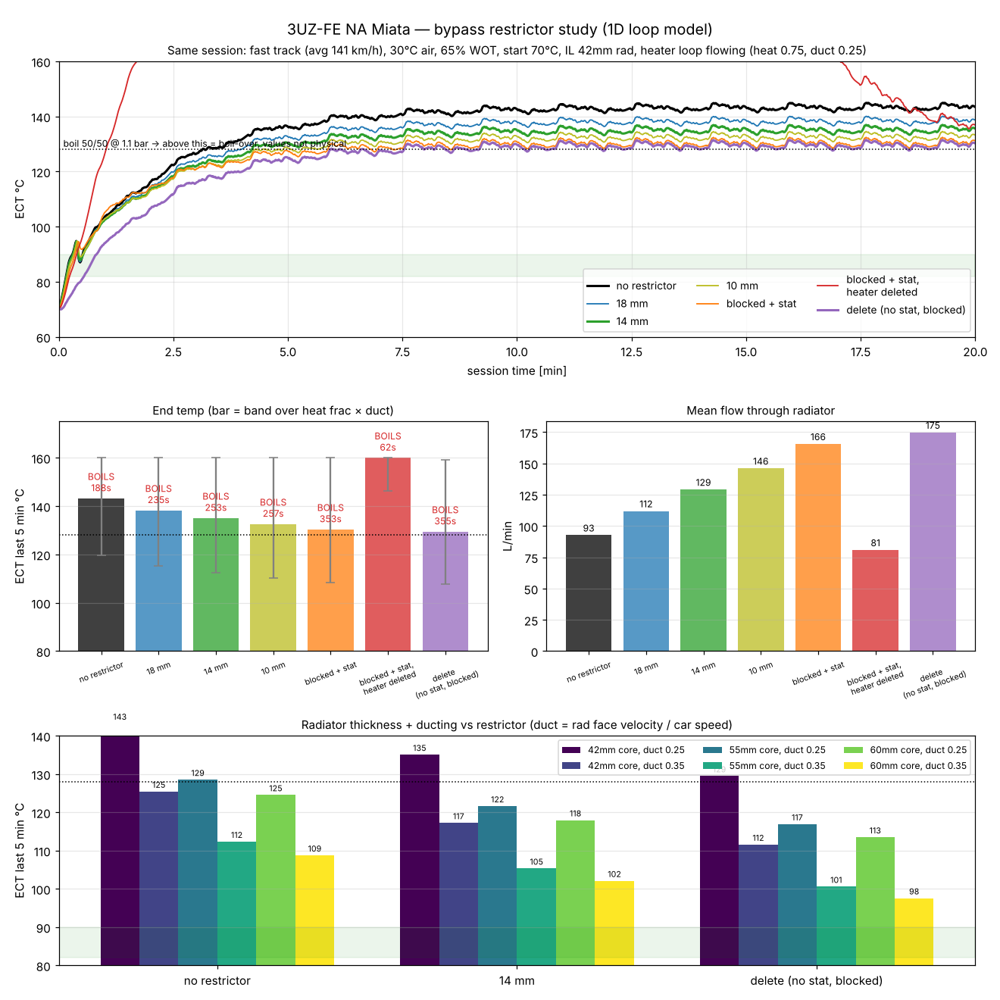

# uz-miata-cooling

## ▶ Open the calculator: **https://uz-miata-cooling.onrender.com**

Move any slider and the charts update immediately: each change simulates a full 20-minute session in ~0.2 s, on any track from **tight (50 km/h average) to fast (160 km/h)**. The default is a fast circuit at 141 km/h average, ≈225 km/h top. Knobs: restrictor bore, thermostat (on/off, opening temp), heater deleted, pump speed, glycol share, Water Wetter, radiator cap, ducting, radiator thickness, air temp, oil cooler (typical sizes list or custom, thickness, mounting, oil thermostat on/off and opening temp), engine power, full-throttle share, track average speed. A pressure-drop panel shows where the pump's head goes, including what a fully open thermostat costs. **Keep to compare** overlays up to 5 runs. **Share** copies a link with your settings: only the values you changed go into the URL, e.g. `?bypass=14&core=60&heater=0`. **Reset** goes back to the defaults.

## Why

UZ V8s (1UZ / 2UZ / 3UZ) swapped into small cars overheat on track. Vendors sell a coolant **bypass restrictor**: a sleeve that narrows the 28 mm bypass in the water inlet housing so more coolant goes through the radiator ([Adapt Lab article](https://adapt-lab.com/2025/07/27/beat-the-heat-why-every-uz-engine-needs-adapt-labs-coolant-bypass-restrictor/)). The article explains the mechanism but shows no test data, and no independent before/after logs could be found.

This project tests that claim with physics for one concrete car: **a stock 3UZ-FE in an NA Miata with a 42 mm aluminium radiator, on a fast track at 30 °C** (average ≈141 km/h). The track-speed slider goes down to 50 km/h average for tight tracks, which put less air through the radiator. It asks three questions. Does the restrictor work? What size? And is it the right fix at all compared with ducting, a thicker radiator or an oil cooler?

## How it calculates

A 1D transient thermal-hydraulic model of the whole coolant loop, stepped every 20 ms over a repeating lap.

### Loop layout

```
pump ─► engine block + heads ─► outlet (ECT sensor) ─┬─► upper hose ─► radiator ─► lower hose ─► THERMOSTAT ─┬─► inlet housing ─► pump
                                                     ├─► bypass 28 mm (+ restrictor) ─────────────────────────┤   (wax pellet sits here)
                                                     └─► heater core (no valve on a Miata: always flows) ──────┘
oil sump ◄─► block (heat exchange) ; oil ─► oil cooler (optional, thermostatic plate)
```

The UZ thermostat is on the **inlet side**: the radiator return and the bypass water mix around the wax pellet before the pump.

### 1. Hydraulics (solved every step)

Every branch is a quadratic loss, `Δp = k·Q²` (k in kPa/(L/s)²). Pipe and fitting losses come from loss coefficients, `k = K·ρ/2 / A²`.

- **Pump** (mechanical, crank speed × pulley ratio n): `Δp = 150·(n/6000)² − 4.0·Q²` kPa. Shut-off 150 kPa at 6000 rpm.
- **Engine block + heads:** k = 4.44 (40 kPa at 180 L/min).
- **Radiator path:** core (15 kPa at 150 L/min) + 38 mm hoses (K≈3) + 38→32→38 mm necks (K≈0.3) + thermostat.
- **Thermostat:** an orifice with `Cd·A = 0.6·(A_jiggle + lift·A_full)`, A_full ≈ 34 mm valve × 10 mm lift (Toyota spec for the UZ thermostat: ≥10 mm at 95 °C). Lift goes linearly from 0 at the opening temp to 1 at opening + 8 °C. The pellet temperature lags the inlet-housing water with τ = 15 s, and also gets a little heat by conduction from the block (15 W/K).
- **Bypass:** 28 mm passage, K≈2.5. The **restrictor** is a sleeve of bore d in the 28 mm bore. Its loss is entry contraction + sudden expansion: `K = 0.5(1−β²)^0.75 + (1−β²)²` (on the sleeve velocity), with `β = d/28`.
- **Heater core:** 16 mm hoses + core, K≈12. A Miata has no heater valve, so unless the heater is deleted this is a small second bypass (~16–29 L/min).

The parallel branches share one pressure drop, so flow splits as `Q_i ∝ 1/√k_i`. The pump operating point is where the pump curve meets `k_engine + k_parallel`. Result for the stock layout at 6000 rpm: ~240 L/min total, 44 % through the radiator.

### 2. Heat input

- 3UZ-FE full-throttle torque: `T = 434 − 66·((rpm − 3400)/2200)²` Nm (434 Nm at 3400, 216 kW at 5600), scaled by the power slider.
- Heat into the engine at full throttle = **fc × brake power**, with fc = 0.75 (calibrated, see below). Off throttle: 8 kW.
- 22 % of that heat goes to the oil (bearings, pistons, valvetrain) and the rest to the metal of the block and heads.

### 3. Thermal nodes

| Node | Capacity | Exchanges with |
|---|---|---|
| Engine metal | 80 kg aluminium-equivalent (72 kJ/K) | coolant jacket, `hA = 4000·(Q/3 L/s)^0.8` W/K (floor 800) |
| Oil | 6 L (10.7 kJ/K) | coolant via block, 800 W/K; oil cooler |
| Jacket coolant (ECT sensor) | 5.5 L, well mixed | pump inflow, metal, oil |
| Upper hose / radiator / lower hose / bypass | 0.8 / 2.4 / 0.8 / 0.2 L | plug flow (6 / 12 / 6 / 3 cells, upwind) |
| Inlet housing (pellet) | 0.3 L | mixes radiator return + bypass + heater |

Plug-flow cells give real transport delays. That's what produces the hot and cold slugs when a thermostat cycles or opens late.

### 4. Radiator

- **Core face:** 560 × 340 mm (NA Miata frame, IL Motorsport NA0-5051, 670 × 415 mm overall).
- **Airflow:** face velocity = `(0.10 + 0.30 × ducting%) × car speed`. 0 % means air spills around the core (10 % of car speed); 100 % means a sealed duct with a hood vent (40 %). Minimum 2.5 m/s from the fans.
- **Air side:** `hA_air = 1700·(v/7)^0.6·(depth/42)^0.8` W/K. That's ~14 m² of louvered fin with h≈140 W/m²K and fin efficiency 0.85 at 7 m/s.
- **Coolant side:** `hA_cool = 6000·(Q_rad/2 L/s)^0.8·(depth/42)` W/K (floor 1500).
- **Heat transfer:** the radiator is split into 12 cells along the coolant path. Each cell is a crossflow exchanger with air as the smaller heat-capacity stream: `ε = 1 − exp(−NTU)` and `q = ε·ṁ_air·cp·(T_coolant − T_air)`.

### 5. Coolant mix

- **Heat capacity:** `cp = 4190 − 11.8·glycol%` J/kgK (3600 at 50/50).
- **Heat transfer:** glycol is more viscous and conducts worse, so the coolant-side heat transfer (engine jacket and radiator tubes) scales as `(1 − 0.007·glycol%)/0.65`. That's 1.0 at 50/50, where the model is calibrated, and ~1.5× for pure water.
- **Water Wetter:** ×1.08 on the same coolant-side heat transfer. It mostly lowers metal temperatures; coolant temperature barely moves because the radiator air side is the limit.
- **Boiling point:** `100 + 0.12·glycol% + 20·cap_bar` °C.

### 6. Oil cooler

- **Size:** face = share of the radiator face. The page shows the matching row count for a 330 mm wide core with 7.2 mm row pitch. Air side scales like the radiator; oil side 500 W/K at 20 % size and 42 mm thickness, scaled by volume.
- **Sizes:** the calculator lists typical stacked-plate coolers (Setrab / Mocal size classes): 10, 13, 16, 19, 25-row (≈210 mm wide) and 19, 25, 34-row wide (≈330 mm), 7.3 mm per row, 50 mm thick. Dimensions are approximate; check the maker's sheet.
- **Oil flow:** 15 L/min through a thermostatic sandwich plate that opens over 10 °C from its set point (default 80 °C; 70–105 selectable), or full flow with the thermostat off. It mostly matters for warm-up and cool days. Heat transfer uses the ε-NTU crossflow formula with both streams unmixed.
- **In front of the radiator:** that strip of radiator gets 75 % of the airflow (two cores in series) at the oil cooler's outlet air temperature.
- **Own duct:** clean ambient air, no penalty on the radiator.

### 7. Track session

- **Track speed:** a lap with six straights. Corner speeds, the top-speed limit and the start speed all scale by one factor, solved so the lap average matches the slider (50–160 km/h). 141 km/h (top ≈225) is a fast circuit; 60 km/h (top ≈113) is a tight club or kart-style track. Slow tracks put less air through the radiator and usually need a lower full-throttle share too. Full-throttle time (65 % by default) accelerates at `a = 5·(1 − (v/65)²)` m/s², scaled with power. Braking at 9 m/s² down to each corner speed (18–30 m/s).
- **Gearing:** five gears, shift point 6500 rpm by default (slider 5500–7000; 3UZ-FE peak power is at 5600, limiters usually sit around 7000). Torque falls off past peak power: `T = 434 − 66·((rpm − 3400)/2200)²` Nm.
- **Start:** whole loop at the start temperature, thermostat closed.
- **Boiling point:** `100 + 0.12·glycol% + 20·cap_bar` °C (50/50 at 1.1 bar ≈ 128 °C). Readings above it aren't physical: the coolant would boil over first.

### 8. Calibration

Two numbers carry most of the uncertainty: **fc** (engine heat into the coolant and oil, per kW of power) and **ducting** (radiator face velocity as a share of car speed). They were checked against:

- **Textbook:** a petrol engine at full load rejects ~0.7–1.0 kW to coolant per kW of brake power (Heywood, *Internal Combustion Engine Fundamentals*).
- **Face velocity:** ~25 % of car speed for a ducted race car ([GT40s forum](https://www.gt40s.com/threads/aero-and-radiators.54970/page-2)), ~40 % for a production car at highway speed.
- **250 whp turbo Miata**, 55 mm Koyo, full ducting and hood vent, ≤21 °C air → ~110 °C on track ([MiataTurbo](https://www.miataturbo.net/race-prep-75/what-considered-normal-hot-track-coolant-temp-64266/)). The model gives 98–112 °C with fc 0.65–0.75.
- **Supercharged Miata** (~140 kW), 37 mm Koyo, summer heat → 96–102 °C (same thread). The model gives 94–104 °C.
- **Adapt Lab** (vendor's own numbers, not independent): UZ under hard use 104 °C and up; with the restrictor and a 77 °C (170 °F) thermostat, 84–89 °C. ([article](https://adapt-lab.com/2025/07/27/beat-the-heat-why-every-uz-engine-needs-adapt-labs-coolant-bypass-restrictor/), [product](https://adapt-lab.com/product/coolant-bypass-restrictor/))

Result: the Miata data fits fc 0.65–0.75. **Default fc = 0.75**, the top of that range, because the 3UZ is a big 4.3 L V8 at 67 hp/L with more hot wall area per kW than the 1.6–1.8 L four-cylinders behind the forum numbers. Ducting default 50 % (face velocity 25 % of car speed). Once the sliders rest, the calculator also re-runs with fc ±0.1 and shows the coolant range.

## Results



Default scenario: 3UZ-FE stock (290 hp, shifting at 6500 rpm), stock water pump, stock inlet-side thermostat (82 °C open / 90 °C full, 10 mm lift, 2 mm jiggle hole, no bypass disc), 28 mm bypass, IL Motorsport 42 mm aluminium radiator in the NA Miata frame, heater loop flowing (no valve), 50/50 coolant, fast circuit (avg ≈141 km/h), 30 °C air, 65 % full throttle, start at 70 °C with the thermostat closed. Engine heat into coolant + oil = 0.75 × power.

| Setup | Flow through radiator | Coolant at sensor, last 5 min |
|---|---|---|
| Stock bypass (28 mm, no restrictor) | 93 L/min (**58 % of the pump flow skips the radiator**: bypass + heater) | 143 °C, boils after ~3.1 min |
| 18 mm restrictor | 112 L/min | 138 °C, boils after ~3.9 min |
| 14 mm restrictor | 129 L/min | 135 °C, boils after ~4.2 min |
| 10 mm restrictor | 146 L/min | 133 °C, boils after ~4.3 min |
| Bypass blocked, thermostat fitted, heater flowing | 166 L/min | 130 °C, boils after ~5.9 min |
| Bypass blocked, thermostat fitted, **heater deleted** | 81 L/min | **boils in ~62 s** (thermostat never sees hot water) |
| Delete kit (no thermostat, bypass blocked) | 175 L/min | 130 °C, boils after ~5.9 min |
| 60 mm radiator + sealed ducting + 14 mm + 19-row wide oil cooler in its own duct | — | **~95 °C** |

- **The restrictor works.** The stock UZ bypass has less resistance than the radiator path, so most of the flow skips the radiator. A restrictor is worth 5–10 °C, with diminishing returns below ~14 mm.
- **It doesn't fix a small radiator.** On the 42 mm radiator every bypass option still boils on a hot fast track. The air side of the radiator is the limit. Sealed ducting (duct 0.25 → 0.35) or a 60 mm core are each worth ~18 °C.
- **Blocking the bypass with the thermostat fitted only works because of the heater loop.** The thermostat sits on the pump inlet and reads the bypass water. With the bypass blocked, the heater core (no valve on a Miata) becomes the only hot flow reaching it, about 30 L/min, which acts like a ~10 mm restrictor. **Delete the heater as well and it boils in about a minute**: the thermostat only sees cold radiator water through its 2 mm hole and opens far too late.
- **A brand-new, fully open thermostat still costs flow.** At 10 mm lift it is ~25 % of the radiator path's resistance: ~3 kPa on the stock layout, ~6 kPa with a 14 mm restrictor. Removing it (bypass kept) raises radiator flow ~9 % (92 → 100 L/min) and is worth only ~2 °C. The thermostat is a minor loss; the bypass is the big one.
- **Oil cooler:** stacked in front of the radiator it removes ~15 kW from the oil but pre-heats 20 % of the radiator to ~78 °C, so coolant drops only 3–5 °C. In its own duct, coolant drops ~14–16 °C. Without one, oil sits at ~160–175 °C.
- **Tight tracks are harder on cooling.** At 60 km/h average there's much less ram air. Even at 40 % full throttle the stock setup boils (~152 °C). The 60 mm radiator + sealed duct + 14 mm + oil cooler in its own duct still holds ~101 °C there.
- **Coolant:** pure water + Water Wetter instead of 50/50 is worth ~10 °C on coolant, but the boiling point drops from 128 to 122 °C at a 1.1 bar cap. Water Wetter alone in 50/50 is worth ~1.5 °C.
- **Calibration matters more than any part:** engine heat 0.65 / 0.75 / 0.85 × power gives 129 / 143 / 158 °C on the stock setup. The ranking between setups doesn't change.
- **Fitment:** the Adapt Lab restrictor fits the 1990–97 non-VVTi and 2002+ 3UZ water inlet housing, part **16032-50110**.

**Accuracy:** absolute temperatures are ±20 °C, because the model is calibrated on forum track data, not on a logged 3UZ Miata. **Differences between setups are the reliable output.** If you have a coolant temperature log from a track session, open an issue: one log pins the calibration.

## Limitations

- No measured 3UZ Miata data yet: absolute temperatures are ±20 °C.
- The restrictor gain assumes turbulent coolant flow in the radiator tubes (h ∝ Q^0.8). If the tubes run laminar, the gain roughly halves.
- No boiling, steam or overflow physics. Coolant just keeps heating above the boiling point, which flags failure but isn't a prediction.
- The "head hot side" trace is a lumped proxy, not a local metal temperature.
- Pump curve and block resistance are estimates (no UZ pump data found).
- Fixed radiator face (NA Miata frame). Fan only sets a minimum air speed.

---

## Repo layout

```
app/app.html     calculator UI (React 18 UMD + htm, hand-drawn SVG charts)
app/sim.js       the model in JavaScript (port of model/uz-cooling-1d.py, parity within 0.1 °C; adds the glycol
                 heat-transfer, Water Wetter and oil-thermostat knobs, which the Python model keeps at defaults)
app/build.sh     inlines sim.js into app.html -> app/index.html (the deployed page)
model/           Python reference model + panel scripts (numpy, matplotlib)
results/         study log, calibration notes, panels
```

## Run it

```sh
# calculator: edit app/app.html or app/sim.js, then rebuild before committing (Render serves app/index.html as-is)
sh app/build.sh && python3 -m http.server -d app 8000   # http://localhost:8000

# Python model
pip install numpy matplotlib
python3 model/uz-cooling-1d.py stock                  # cases: stock | r18 | r14 | r10 | blocked | blockedNH | delete  (--no-heater = heater deleted)
python3 model/uz-cooling-1d.py r14 --core 60 --duct 0.35 --oc side --tair 35
```

Deployed on Render as a static site (publish directory `app`, auto-deploy on push to `main`).

## License

MIT, see [LICENSE](LICENSE).
